# Element Blast

Прототип казуальной головоломки для RuStore: **Block Blast + песочница стихий**.

Игрок ставит фигуры на поле **6×6, 8×8 или 10×10**. Каждые **2 хода**
начинается длинная фаза проявления: каждая занятая клетка рассыпается на 8×8
частиц, и всё поле превращается в песочницу (например, 64×64 для поля 8×8).
Вода растекается и выравнивается, песок осыпается, вязкая лава реагирует с
водой, кислота растворяет твёрдые частицы.
**Огонь** поджигает нефть и ростки, **нефть** плавает на воде, **росток** пьёт
воду и растёт, а **порох** взрывается от огня и лавы.

Каждую секунду в фазе случается выброс: прилив, извержение, кислотный дождь,
песчаная буря, нефтяной дождь или пороховой залп — четыре случайных из пула.
После проявления поле собирается в блоки N×N волной кристаллизации, а полные
линии очищаются.

**Температура** меняется каждый ход на случайные градусы. Жара плавит лёд,
кипятит воду и нагревает камень; холод замораживает воду, ускоряет застывание
лавы, а при лютом холоде начинает идти снег. Фон и поле окрашиваются в тон
температуры.

**Событие** приходит случайно во время партии: наводнение, огненный шторм,
ледниковый период или цветение. Оно длится несколько ходов, меняет погоду, фон,
состав лотка и выбросы, а затем уходит до следующего события.

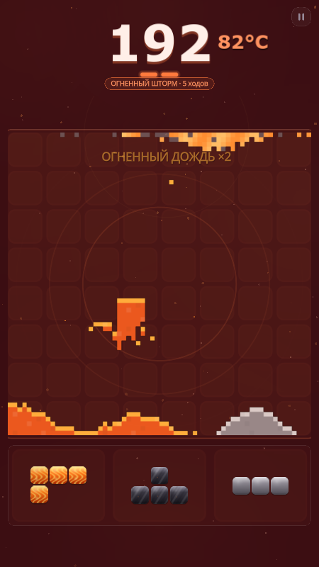

---

## Скачать

Готовые сборки лежат в **GitHub Releases**:

- **Windows (x64, portable):**
  [ElementBlast-windows-x64.exe](https://github.com/igorrais82/element-blast/releases/latest/download/ElementBlast-windows-x64.exe)
- **Android (APK, release-подпись, universal):**
  [ElementBlast-android.apk](https://github.com/igorrais82/element-blast/releases/latest/download/ElementBlast-android.apk)
  — arm64-v8a + armeabi-v7a + x86_64, Android 7.0+.
- **Исходники и документация:** этот репозиторий.

Все версии: <https://github.com/igorrais82/element-blast/releases>

Windows-сборка не требует установки: запустить exe можно из любой папки.

### Если Android пишет «Приложение не установлено»

1. Скачайте APK **заново** из последнего релиза. Размер файла — около **79 МБ**.
2. Если раньше уже стояла debug-версия Element Blast — **удалите её**: у новой
   сборки другая подпись.
3. Разрешите установку из неизвестных источников для браузера или файлового
   менеджера: «Настройки → Приложения → Специальный доступ → Установка
   неизвестных приложений».
4. Если Play Protect предупреждает — нажмите «Подробнее» → «Установить всё равно».
5. Не открывайте APK из архиватора или предпросмотра: сначала сохраните файл
   полностью, затем откройте его через файловый менеджер.

SHA-256 последней Android-сборки:
`756F86F156E4102BECE5435D2259BA1B7EFB358D008143A408A88E7BD7C28BDC`

---

## Как запустить

### Готовый ярлык

На рабочем столе: **Element Blast**  
`C:\Users\User\Desktop\Element Blast.lnk`

Ярлык ведёт на собранный exe:

```
C:\Projects\Element Blast\build\windows\ElementBlast.exe
```

Можно запускать и сам exe. Сборка standalone (PCK встроен в exe), ничего рядом
копировать не нужно.

### Из Godot

Открыть `project.godot` в **Godot 4.7.2** и нажать F5. На этой машине Godot
установлен через Steam:

```
C:\Program Files (x86)\Steam\steamapps\common\Godot Engine\godot.windows.opt.tools.64.exe
```

---

## Управление

- **Перетаскивание** — схватить фигуру из лотка и отпустить на поле.
- **Тап по фигуре → тап по клетке** — альтернативный способ (удобно на телефоне).
- **Пауза** — кнопка «II» в правом верхнем углу или Esc.
- **Звук** — переключатель в меню паузы (состояние сохраняется).

Фигуры не вращаются: как в Block Blast, форма приходит уже готовой.

---

## Главное меню и настройки

Главное меню минимальное, как в Block Blast:

- логотип **ELEMENT BLAST**;
- **ИГРАТЬ**;
- **ОБУЧЕНИЕ**;
- **НАСТРОЙКИ**;
- **Рекорд**.

В настройках выбираются:

- **Тема** — тёмная или светлая; сохраняется в профиле.
- **Размер поля** — 6×6, 8×8 или 10×10; песочница масштабируется вместе с полем.

Тема и размер применяются сразу, после чего настройки открываются снова с уже
выбранным вариантом. Рекорд и звук при этом сохраняются.

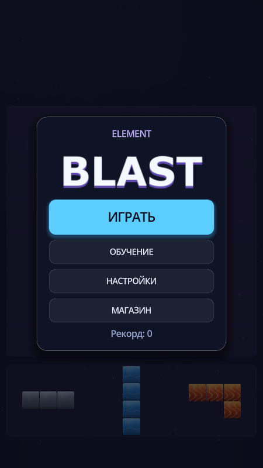
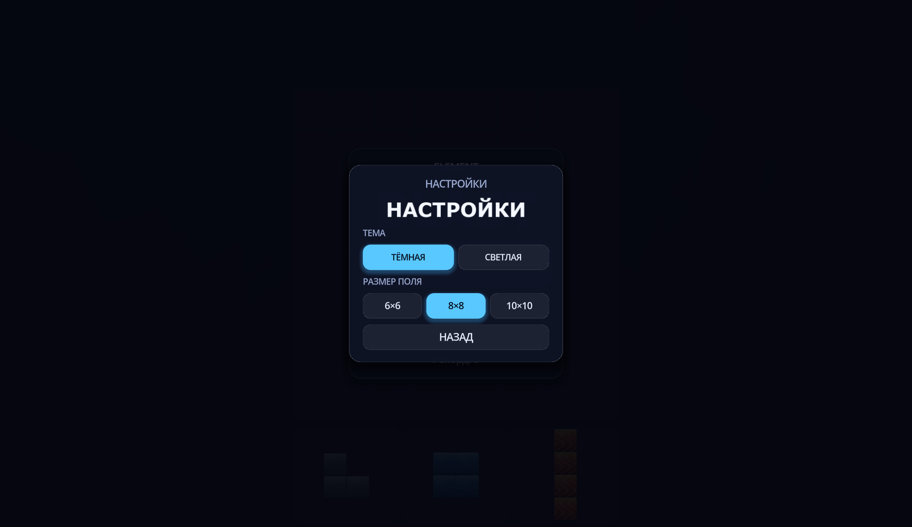
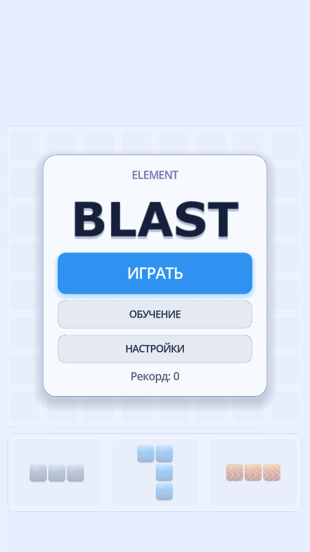
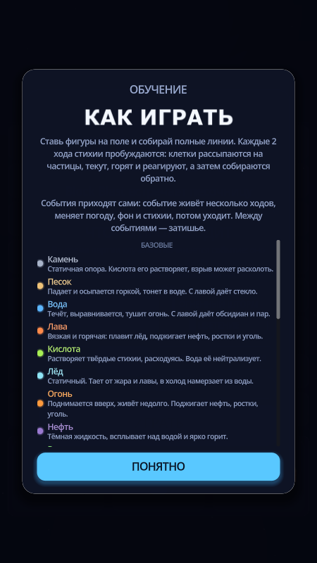

---

## Иконка

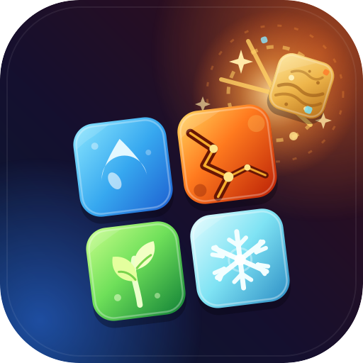

Четыре блока-стихии — **вода, лава, росток и лёд** — собраны на фоне поля, а
пятый, песочный, вылетает из взрыва. Иконка показывает обе главные идеи игры:
расстановку блоков и пробуждение стихий.

---

## Механики

### Пробуждение

Счётчик под счётом показывает, сколько ходов осталось до пробуждения (две
точки: 2 → 1 → 0).

В момент пробуждения каждая занятая клетка превращается в блок **8×8 частиц**:
поле N×N разворачивается в симуляцию **N·8×N·8** (64×64 для поля 8×8,
до 6400 частиц для 10×10). Частицы живут по правилам falling-sand: гравитация,
растекание, вязкость, химические реакции. Вода действительно наливается и
выравнивается, песок образует горки, лава расползается медленным вязким пятном.

Фаза длится до **~5 секунд** и не даёт заскучать: на тиках 30/78/126/174
в поле врываются четыре случайных выброса из пула: **ПРИЛИВ**, **ИЗВЕРЖЕНИЕ**,
**КИСЛОТНЫЙ ДОЖДЬ**, **ПЕСЧАНАЯ БУРЯ**, **НЕФТЯНОЙ ДОЖДЬ** и
**ПОРОХОВОЙ ЗАЛП**. В событии вместо случайного пула падает тематический
элемент, обычно **×2**. Каждый выброс — это колонна частиц сверху, луч, кольцо,
подпись и звук.

После последнего выброса поле «кристаллизуется» обратно в N×N волной от
верхнего левого угла. Клетки собираются по объёму частиц каждого элемента,
поэтому вода, растёкшаяся тонким слоем, возвращается примерно тем же
количеством блоков, а не исчезает и не размножается. Затем очищаются полные
линии.

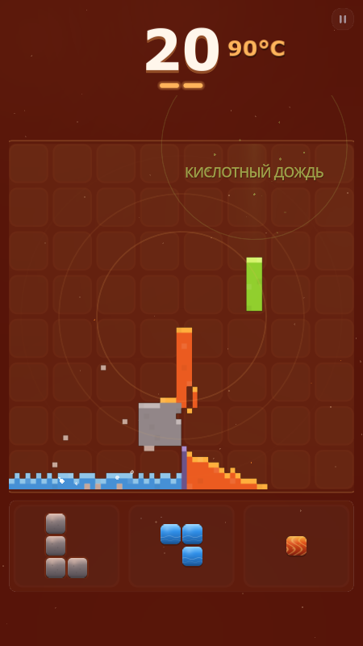

### Температура

Каждый ход температура случайно меняется на **8–30 °C**. Шкала идёт от
**−40 °C** до **+100 °C**, старт — **+20 °C**. В HUD крупные градусы стоят рядом
со счётом; фон, поле и лоток окрашиваются в тон температуры, а на доске
появляются снег или раскалённые искры.

| Диапазон | Что происходит в фазе проявления |
|---|---|
| **≤ −10 °C · ЛЮТЫЙ ХОЛОД** | Вода быстро замерзает, лава очень быстро застывает, падает снег. |
| **−10…+10 °C · ХОЛОД** | Вода медленно превращается в лёд, лава застывает быстрее обычного. |
| **+10…+30 °C · НОРМА** | Температурных изменений нет. |
| **+30…+60 °C · ЖАРА** | Лёд тает, лава медленно застывает. |
| **> +60 °C · ПЕКЛО** | Лёд тает мгновенно, вода кипит, лава не застывает, камень раскаляется и может расплавиться. |

Эффекты температуры работают во время проявления; градусы и диапазон
сохраняются между ходами.

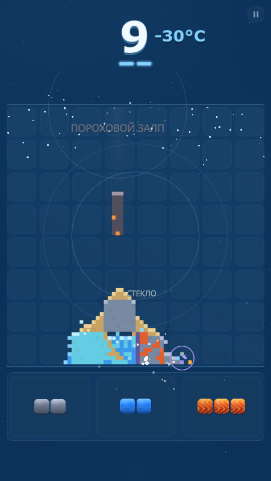

### События

События приходят **случайно во время партии**. Событие живёт **4–7 ходов**,
задаёт погоду, цвет фона, состав лотка и выбросы, а затем уходит. После этого
наступает **затишье на 3–6 ходов**, и приходит следующее событие — уже другое.
Температура внутри события фиксирована, поэтому каждый ход её не меняет.

| Событие | Погода | Что происходит | Новые стихии |
|---|---|---|---|
| **НАВОДНЕНИЕ** | −5 °C | С неба падает только вода ×2, вся лава сразу становится камнем, в лотке много воды; на фоне волны и рыбы. | Водоросли, Губка |
| **ОГНЕННЫЙ ШТОРМ** | +82 °C | С неба льётся лава ×2, вода быстро выкипает, растения и нефть вспыхивают сами; в лотке много огня. | Уголь, Пепел |
| **ЛЕДНИКОВЫЙ ПЕРИОД** | −33 °C | С неба валит снег ×2, вода быстро замерзает, лава стынет; в лотке много льда и снега. | Снег, Кристалл |
| **ЦВЕТЕНИЕ** | +22 °C | С неба падают ростки ×2, растения растут в несколько раз быстрее, споры разносятся по полю. | Споры, Цветок |

Пока событие активно, в лоток гарантированно попадает хотя бы один из двух
тематических элементов. Над полем под счётом появляется плашка с названием
события и числом оставшихся ходов, а после окончания — баннер «ЗАТИШЬЕ».

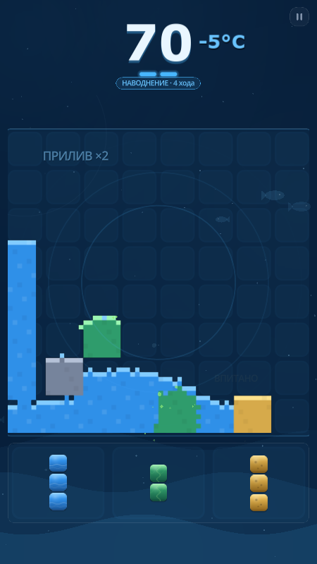

### Ивентные стихии

| Элемент | Поведение |
|---|---|
| **Водоросли** | Статичны, но растут вверх и в стороны, поглощая воду. Горят от огня и лавы. |
| **Губка** | Впитывает соседнюю воду, а при нагреве отдаёт её обратно паром. |
| **Уголь** | Долго горит от огня или лавы, давая много пламени. |
| **Пепел** | Лёгкий: плавает на воде, не тонет, разлетается от взрывов. |
| **Снег** | Падает как песок, тает от жара, а на лютом холоде спрессовывается в лёд. |
| **Кристалл** | На холоде растёт сквозь воду и лёд, взрыв раскалывает его на лёд. |
| **Споры** | Летают по полю и прорастают в росток или цветок рядом с водой. |
| **Цветок** | Выпускает споры, горит от огня и лавы. |

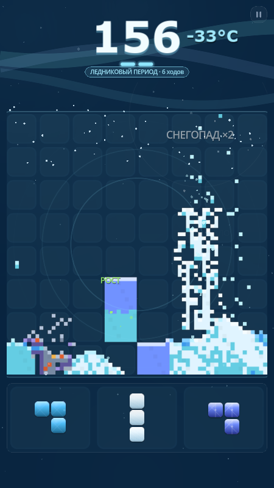

### Стихии

| Элемент | Поведение |
|---|---|
| **Камень** | Статичная частица-структура. Кислота его растворяет. |
| **Песок** | Падает, осыпается по диагонали, тонет в воде/кислоте, копится горкой. |
| **Вода** | Течёт вниз и в стороны, заполняет пустоты и выравнивает поверхность. Рядом с лавой даёт **обсидиан + пар**, разбавляет кислоту. |
| **Лава** | Вязкая: движется медленно, расползается неохотно. С водой даёт обсидиан, плавит лёд, поджигает нефть и ростки, с песком даёт стекло. |
| **Кислота** | Растворяет камень, песок, лёд, обсидиан, росток и стекло, расходуясь частица за частицей. Вода её нейтрализует. |
| **Лёд** | Статичен. Рядом с лавой тает. |
| **Огонь** | Поднимается вверх, живёт недолго. Поджигает нефть и ростки, плавит лёд, гаснет от воды. |
| **Нефть** | Тёмная жидкость, растекается и всплывает над водой. Загорается от огня и лавы, оставляя дым. |
| **Росток** | Статичен, но пьёт соседнюю воду и превращает её в новые побеги. Горит от огня и лавы, растворяется кислотой. |
| **Порох** | Сыпучий, падает и копится. При контакте с огнём или лавой взрывается: сносит жидкости, песок, растения и стекло, оставляя камень/обсидиан. |
| **Обсидиан** | Продукт реакции воды и лавы. Статичен, кислота его растворяет. |
| **Стекло** | Продукт реакции лавы и песка. Статичное, кислота его травит, взрыв разбивает. |
| **Пар** | Поднимается вверх и рассеивается. |
| **Дым** | Продукт горения и взрывов. Медленно поднимается и тает. |

Всего в игре **10 базовых стихий** (камень, песок, вода, лава, кислота,
лёд, огонь, нефть, росток, порох), **8 ивентных** (водоросли, губка, уголь,
пепел, снег, кристалл, споры, цветок) и продукты: обсидиан, стекло, пар, дым.

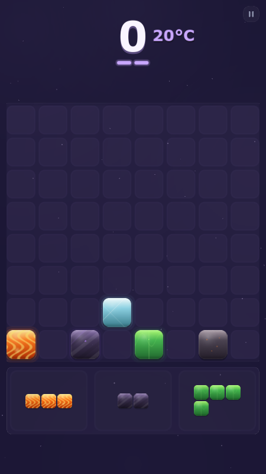

### Очки

- Постановка фигуры: +1 за клетку.
- Очистка линии: +10 за клетку × количество линий (например, 2 линии и 16 клеток = 320).
- Реакции: очки начисляются по количеству прореагировавших частиц (обсидиан, растворение, таяние, нейтрализация).
- Рекорд хранится в `user://element_blast.cfg`.

### Конец игры

Если ни одна из оставшихся фигур не помещается на поле — игра окончена.
После трёх поставленных фигур лоток пополняется новым набором.

---

## Что уже реализовано

- Полный игровой цикл: меню → игра → пауза → game over → рестарт.
- Drag & drop и tap-to-place, ghost-предпросмотр, подсветка невалидной позиции.
- Настоящая falling-sand симуляция: N×N частиц (до 80×80), гравитация,
  растекание, вязкость, химические реакции, пар и обсидиан.
- Переход «клетки → частицы → клетки»: распад на частицы при пробуждении и
  объёмное квантование обратно в блоки после.
- **10 базовых стихий + 8 ивентных + 4 продукта**, у каждой — своя механика:
  горение, плавучесть, рост, взрывы, стекло, дым.
- **4 события**, которые случайно приходят во время партии: наводнение,
  огненный шторм, ледниковый период и цветение. Событие живёт 4–7 ходов, затем
  уходит, после 3–6 ходов затишья приходит следующее. Событие задаёт погоду,
  фон, состав лотка и тематический выброс ×2.
- **Тёмная и светлая темы**: переключатель в меню, отдельные палитры фона,
  поля, панелей, текста и кнопок; настройка сохраняется.
- **Размер поля 6×6, 8×8 или 10×10**: песочница масштабируется вместе с полем
  (6×6 → 48×48 частиц, 10×10 → 80×80).
- **Обучение**: отдельный экран с прокруткой, где объяснены базовые стихии,
  продукты и все ивентные элементы.
- **Температура**: шкала от −40 до +100 °C, случайное изменение на 8–30 °C
  каждый ход, таяние, кипение, замерзание, застывание лавы, нагрев камня,
  снег и жар; крупные градусы в HUD и фон в тон температуры.
- Новые спрайты клеток: градиент, блик, фаска, узоры стихий, тени и три
  варианта текстуры на элемент (чтобы узор не повторялся на соседних клетках).
- Фигуры в лотке центрируются по своим настоящим границам; исправлена
  ориентация фигур (раньше широкая фигура рисовалась вертикально и не вставала
  в правые/нижние клетки поля).
- Динамичная фаза проявления: четыре случайных выброса из пула, лучи, кольца,
  подписи, вспышки, взрывы пороха, тряска и звуки; кристаллизация волной.
- «Живое» поле между ходами: амбиент-частицы над лавой/водой/кислотой/льдом,
  пульсация подсветки, покачивание фигур в лотке.
- Анимированный счётчик очков, всплывающие +N, подписи реакций, комбо-текст,
  конфетти и усиленный screen shake на линиях.
- Минималистичный HUD: огромный счёт по центру без подписи, крупные градусы
  рядом, две точки заряда пробуждения и лёгкая кнопка паузы; во время события
  под счётом появляется плашка с его названием и остатком ходов. Меню паузы
  содержит переключатель звука, а фон и поле меняют цвет вместе с температурой.
- Минимальное главное меню: логотип, «Играть», «Обучение», «Настройки» и рекорд.
  Тема и размер поля вынесены в настройки.
- Очистка линий, комбо за несколько линий, очки, рекорд.
- Частицы, всплывающие очки, тряска, вспышка, аура пробуждения.
- Процедурные звуки: постановка, выбор фигуры, очистка, комбо, реакции,
  пробуждение, выбросы, кристаллизация, game over. Переключатель mute
  с сохранением.
- Сохранение рекорда и настройки звука.
- Новая иконка: четыре блока-стихии, вылетающий песочный блок и взрыв.
- Windows-сборка + ярлык на рабочем столе.

---

## Структура проекта

```
project.godot              настройки проекта (720×1280, portrait, GL Compatibility)
scenes/Main.tscn           единственная сцена
scripts/
  SandSim.gd               falling-sand N×N: движение, химия, квантование
  ElementGame.gd           правила, размер поля, события, пробуждение
  EventDefs.gd             данные событий: погода, правила, стихии, веса
  ElementInfo.gd           описания всех стихий для обучения
  ThemeKit.gd              палитры тёмной и светлой темы
  BoardView.gd             отрисовка поля/лотка/жидкости, ввод, частицы, попапы
  Main.gd                  HUD, меню, обучение, темы, размер поля, оверлеи, звук
  Profile.gd               автолоад: рекорд, mute, тема и размер поля
  Sfx.gd                   процедурная генерация звуков
  Backdrop.gd              фон: температура, волны, рыбы, сияние, лепестки
docs/
  icon.png                  иконка игры в 512×512
  screenshot.png             скриншот с событием и плашкой события
  screenshot_menu.png        главное меню
  screenshot_settings.png    настройки темы и размера поля
  screenshot_light.png       светлая тема
  screenshot_tutorial.png    экран обучения
  screenshot_board10.png     поле 10×10
  screenshot_fluid.png       скриншот жидкой фазы и выбросов
  screenshot_elements.png    витрина новых стихий
  screenshot_temperature.png лютая стужа и снег
  screenshot_flood.png       событие «Наводнение»
  screenshot_firestorm.png   событие «Огненный шторм»
  screenshot_ice_age.png     событие «Ледниковый период»
  screenshot_bloom.png       событие «Цветение»
tools/
  LogicTest.tscn/.gd       headless-тесты правил и симуляции
  InputTest.tscn/.gd       headless-тест тапа и drag&drop
  MakeIcon.gd              SVG → docs/icon.png и assets/icon.ico
assets/
  icon.svg                 иконка игры: блоки стихий и взрыв
  icon.ico                 иконка для ярлыка Windows
  icons/                   иконки кнопок (пауза)
build/windows/             готовая Windows-сборка
```

---

## Где крутить баланс

`scripts/SandSim.gd`:

- `SUB` — сколько частиц в одной клетке по каждой оси (8): поле N×N даёт
  песочницу N·8×N·8. Менять только вместе с логикой квантования.
- `DEFAULT_CELLS` — размер поля по умолчанию для песочницы (8).
- `TICK_RATE` — частота симуляции (45 тиков/с), `MAX_TICKS` — предел длительности
  (220 тиков ≈ 4.9 с). Это основные ручки производительности.
- `_step_sand()` / `_step_liquid()` / `_step_steam()` — физика частиц;
  `horizontal_chance` управляет «текучестью» воды, кислоты и лавы.
- `inject_column()` — колонна частиц для выбросов, `top_is_free()` — выбор места.
- `_react_lava()` / `_react_acid()` / `_react_fire()` — химия;
  `_react_plant()` — рост; `_react_gunpowder()` / `_explode()` — взрывы.
- `_react_seaweed()` / `_react_sponge()` / `_react_coal()` / `_react_spore()` /
  `_react_flower()` / `_react_crystal()` — поведение ивентных стихий.
- `_apply_event_rule()` — правила событий: лава → камень, усиленное замерзание,
  испарение воды и возгорание растений в огненном шторме.
- Вероятность роста ростка (`0.003`), водорослей (`0.010`), кристалла (`0.004`),
  шанс стекла (`0.045`) и радиус взрыва (`5` частиц) — главные ручки баланса.
- `_apply_temperature()` — таяние/кипение/замерзание/застывание; вероятности
  на тик: лёд при жаре `0.006`, вода при пекле `0.003`, лёд при пекле — сразу,
  вода при лютом холоде `0.008`, лава при лютом холоде `0.010`. В наводнении
  вода не замерзает, чтобы событие оставалось водным.
- `_shift_temperature()` в `ElementGame.gd` — случайный сдвиг на
  `TEMP_STEP_MIN…TEMP_STEP_MAX` (8–30 °C) каждый ход; в событиях температура
  фиксирована. Диапазоны состояний задаются в `_temperature_level()`.
- `quantize()` — сборка N×N обратно: минимальный объём элемента и бюджет клеток.

`scripts/EventDefs.gd`:

- `EVENTS` — список событий: название, погода, фон (тёмный/светлый), акцент,
  выброс, веса элементов и две ивентные стихии.
- `ELEMENT_NAMES` / `ELEMENT_COLORS` — подписи и цвета ивентных стихий.
- `pick()` — случайное событие с исключением предыдущего.

`scripts/ElementGame.gd`:

- `AWAKEN_EVERY` — как часто пробуждаются стихии (сейчас 2).
- `AWAKEN_DELAY` — пауза перед стартом частиц (0.35 с).
- `SURGE_TICKS` — когда случаются выбросы (30/78/126/174 тика).
- `SURGE_POOL` — пул элементов и подписей обычной партии; в событии заменяется
  тематическим выбросом с множителем.
- `MAX_STEPS_PER_FRAME` — защита от спирали смерти при просадке FPS.
- `EVENT_FIRST_MIN…EVENT_FIRST_MAX` — задержка первого события,
  `EVENT_DURATION_MIN…EVENT_DURATION_MAX` — длительность события,
  `EVENT_COOLDOWN_MIN…EVENT_COOLDOWN_MAX` — затишье между событиями (в ходах).
- `SHAPES` — набор фигур и их веса, `ELEMENT_WEIGHTS` — частота элементов
  обычной партии; в событии берутся веса из `EventDefs`.

`scripts/BoardView.gd`:

- `PALETTE` — цвета, свечение и частицы элементов.
- `_build_cell_textures()` — генерация спрайтов (3 варианта на элемент).
- `_build_sand_texture()` — палитра жидкости, подсветка поверхности, шиммер.
- `SAND_FADE_TIME` — длительность «кристаллизации» обратно в блоки.
- `_add_ring()` / `_add_beam()` / `_spawn_ambient()` — кольца, лучи и амбиент.
- `_draw_cell()` — внешний вид обычных клеток; `_draw_pattern()` больше не используется.

`scripts/Main.gd`:

- Размеры шрифтов, отступы, тексты, кнопки, оверлеи.
- `_build_tutorial_overlay()` — экран обучения с прокруткой.
- `_build_settings_overlay()` — тема и размер поля в настройках.
- `_update_event_hud()` — плашка с названием события и остатком ходов.
- `_set_theme()` / `_set_board_size()` — настройки, перезапускают меню.
- `_refresh_event_visuals()` — передаёт тему активного события в фон и поле.
- `_update_live_scoring()` — живой счётчик и пульс точек пробуждения.
- `_update_temperature_ui()` — цвет фона/акцента, крупные градусы и пульс шкалы.
- `_count_label()` — анимация финального счёта.
- Скрытые флаги `--screen=start|pause|gameover` и `--event=flood` для скриншотов.

`scripts/Backdrop.gd`:

- `set_event()` / `clear_event()` — тема события и её плавная смена.
- `_draw_flood()` — волны, рыбы и пузыри.
- `_draw_firestorm()` — искры и жар у нижнего края.
- `_draw_aurora()` — сияние и снежинки.
- `_draw_bloom()` — лепестки и споры.

`scripts/ThemeKit.gd`:

- `mode` — `"dark"` или `"light"`.
- `text_primary()` / `panel_bg()` / `overlay_dim()` / `board_cell()` — палитра
  для тёмной и светлой темы.
- Светлые фоны событий задаются в `EventDefs` полем `bg_light`.

`scripts/ElementInfo.gd`:

- `ELEMENTS` — названия, цвета и описания всех базовых, ивентных стихий и
  продуктов для экрана обучения.

---

## Тесты

Логика и симуляция:

```powershell
& "C:\Program Files (x86)\Steam\steamapps\common\Godot Engine\godot.windows.opt.tools.64.exe" `
  --headless --path "C:\Projects\Element Blast" res://tools/LogicTest.tscn
```

Ввод (тап + drag&drop):

```powershell
& "C:\Program Files (x86)\Steam\steamapps\common\Godot Engine\godot.windows.opt.tools.64.exe" `
  --headless --path "C:\Projects\Element Blast" res://tools/InputTest.tscn
```

`LogicTest` проверяет очистку линий, падение песка, растекание воды, реакцию
лавы с водой, растворение камня кислотой, поджиг нефти, рост растения,
взрыв пороха, появление стекла, температуру (сдвиг на градусы, мгновенное
тайание, кипение, замерзание воды и застывание лавы), динамические события
(задержка, старт, длительность, затишье после), восемь ивентных стихий
(водоросли, губка, уголь, пепел, снег, кристалл, споры, цветок), размеры поля
6×6/8×8/10×10 с масштабированием песочницы, квантование новых элементов,
интеграцию пробуждения и короткую случайную партию с инвариантами поля.
`InputTest` — выбор фигуры, tap-to-place и drag-to-place через `BoardView`.

### Debug-флаги (только для разработки)

```powershell
# Скриншот меню через 1.2 c
ElementBlast.exe -- --shot=C:/tmp/menu.png

# Автодемо: игра сама ставит фигуры, скриншот через 7 c
ElementBlast.exe -- --demo --delay=7 --shot=C:/tmp/game.png

# Скриншоты оверлеев
ElementBlast.exe -- --screen=pause --delay=1.2 --shot=C:/tmp/pause.png
ElementBlast.exe -- --screen=gameover --delay=1.2 --shot=C:/tmp/over.png

# Витрина новых стихий и взрыв пороха
ElementBlast.exe -- --screen=elements --delay=1.4 --shot=C:/tmp/elements.png
ElementBlast.exe -- --screen=boom --delay=1.05 --shot=C:/tmp/boom.png

# Температурные крайности
ElementBlast.exe -- --screen=hot --delay=1.5 --shot=C:/tmp/hot.png
ElementBlast.exe -- --screen=cold --delay=1.5 --shot=C:/tmp/cold.png

# События: игровые витрины
ElementBlast.exe -- --screen=flood --delay=2.6 --shot=C:/tmp/flood.png
ElementBlast.exe -- --screen=firestorm --delay=2.6 --shot=C:/tmp/fire.png
ElementBlast.exe -- --screen=ice_age --delay=2.6 --shot=C:/tmp/ice.png
ElementBlast.exe -- --screen=bloom --delay=2.6 --shot=C:/tmp/bloom.png

# Меню, настройки, темы, размер поля и обучение
ElementBlast.exe -- --delay=1.5 --shot=C:/tmp/menu.png
ElementBlast.exe -- --screen=settings --delay=1.4 --shot=C:/tmp/settings.png
ElementBlast.exe -- --theme=light --delay=1.5 --shot=C:/tmp/light.png
ElementBlast.exe -- --theme=light --size=10 --screen=start --delay=1.5 --shot=C:/tmp/light10.png
ElementBlast.exe -- --screen=tutorial --delay=1.4 --shot=C:/tmp/tutorial.png
```

---

## RuStore: что делать дальше

Прототип собран под Windows для быстрой проверки. Для RuStore нужен Android-билд:

1. Установить **Android Studio / Android SDK** и **JDK 17**, указать пути в
   `Editor Settings → Export → Android`.
2. Создать keystore (debug для теста, release для публикации) и прописать его
   в экспортном пресете Android.
3. В `Project → Export → Android` задать:
   - package name, например `ru.yourstudio.elementblast`;
   - version code/name;
   - portrait orientation;
   - иконку 512×512 (можно отрендерить из `assets/icon.svg`);
   - min/target SDK по актуальным требованиям RuStore.
4. Собрать **AAB** (или APK), проверить на устройстве, загрузить в RuStore Console.
5. Для монетизации позже подключить RuStore SDK (биллинг/реклама) и аналитику.
   На текущем этапе SDK не нужен — игра бесплатная и без встроенных покупок.

Важно: текущая сборка использует `GL Compatibility` — это хороший выбор для
широкого парка Android-устройств. Touch-ввод уже работает через эмуляцию мыши
(`emulate_mouse_from_touch=true`), но перед публикацией стоит отдельно проверить
на реальном телефоне с высоким DPI и вырезом экрана.

---

## Ограничения прототипа

- Только бесконечный режим, без уровней, целей и мета-прогрессии.
- Четыре события приходят случайно во время партии; отдельного режима
  «без события» нет.
- Температура глобальная (числовая, −40…+100 °C), без локального тепла на клетках.
- Поддерживаются только квадратные поля 6×6, 8×8 и 10×10; произвольный размер
  и прямоугольные поля не входят в прототип.
- Русский язык; локализация не подключена.
- Нет музыки, только процедурные SFX.
- Нет undo/бустеров, rewarded-рекламы и IAP.
- Жидкость — упрощённая песочница N×N: без давления и локальной температуры,
  без идеальной сохранности массы. После пробуждения объём **приблизительно**
  пересобирается в клетки N×N.
- На слабых Android-устройствах может понадобиться уменьшить `TICK_RATE`/`MAX_TICKS`.
- Android-сборка не собрана: нужны SDK/keystore (см. выше).
- Ярлык указывает на `build/windows/ElementBlast.exe`; если перенести папку
  проекта, ярлык нужно пересоздать.

---

## Идеи для следующей итерации

- Цели уровня: «собери 3 обсидиана», «очисти 5 линий», лимит ходов.
- Новые события: кислотный дождь, песчаная буря, метеоритный дождь.
- Новые стихии: ртуть, магнитные жидкости, лёд-2, грибница.
- Постоянный sandbox-режим или уровни, где поле не кристаллизуется обратно.
- Бустеры: молот, замена фигуры, undo, «заморозка» поля.
- Ежедневные задания и коллекция открываемых элементов.
- Обучение руками: подсветка первого drag, подсказка про реакцию.
- Мета: скины поля, рейтинг, облачное сохранение.
- RuStore SDK: реклама за награду, покупка «убрать рекламу», аналитика.

---

Сделано на **Godot 4.7.2**. Иконки и звуки сгенерированы внутри проекта,
внешних ассетов нет.
